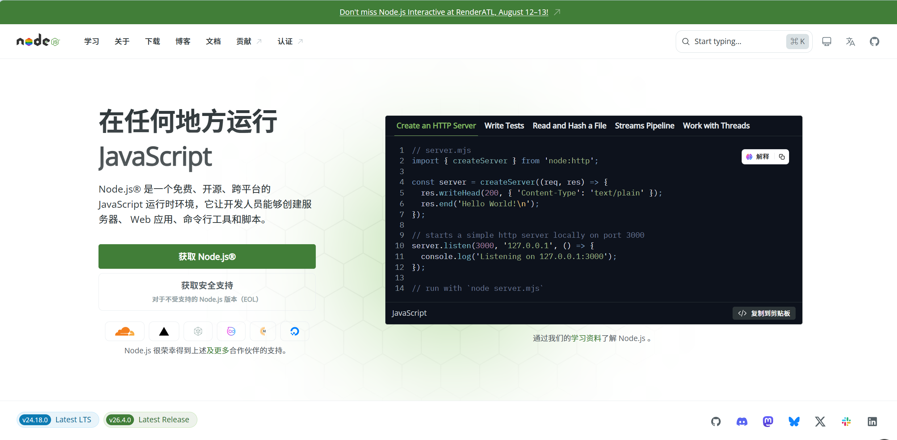
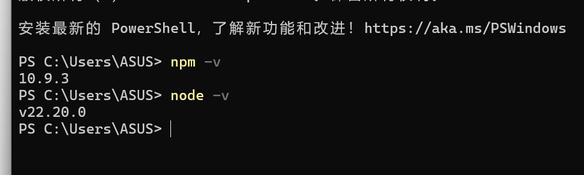
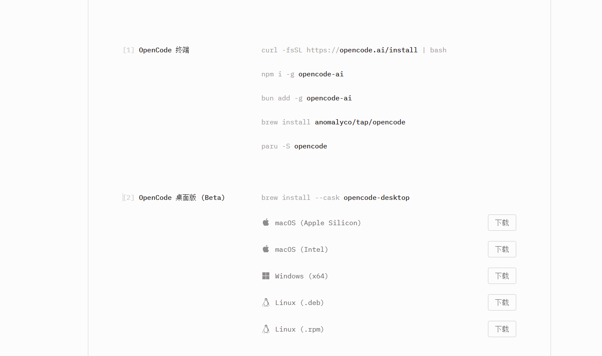
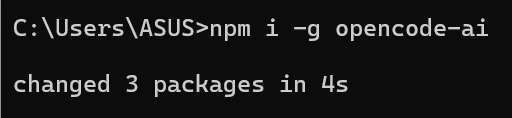
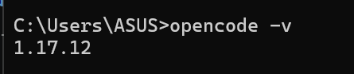
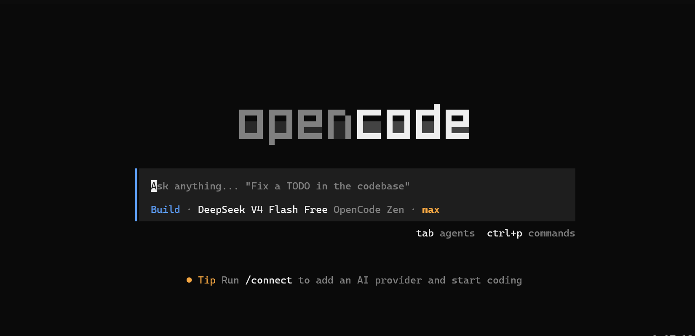
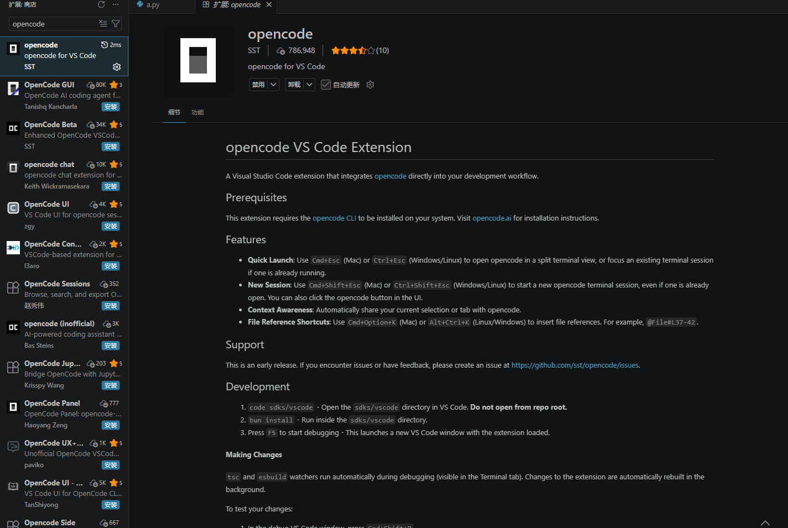
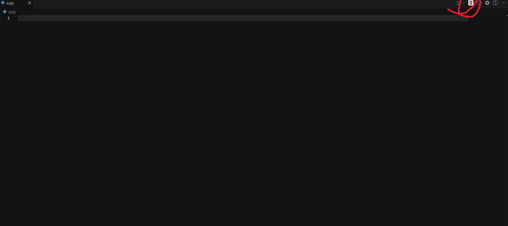

# **如何快速安装opencode**

## **1. 安装node.js**

### 1.1 在浏览器搜索(https://nodejs.org/zh-cn)

### 1.2 点击页面中的获取node.js按钮，安装相应版本即可（我用的是windows）


### 1.3 安装完成后，在cmd中输入node -v，查看是否安装完成；接下来输入npm -v，查看是否安装完成，显示效果如下：


## **2.安装opencode**

### 2.1 在浏览器搜索(https://opencode.ai/zh/download)
### 安装windows版本即可


### 2.2 安装完成后，在cmd中输入以下命令安装opencode
```
npm i -g opencode-ai
```


### 2.3 在cmd中输入以下命令，查看opencode是否安装成功
```
opencode -v
```


### 2.4 使用opencode：在cmd中输入以下命令启动opencode
```
opencode
```
### 效果图如下：



### 其中，可以在当前窗口下输入相应命令使用opencode
### 例如，使用
```
/models
```
### 查看可使用的模型列表


## **3. 在vs code中使用opencode**

### 3.1 安装vs code中的opencode插件
#### 1. 打开vs code
#### 2. 点击左侧活动栏中的扩展图标（四个方块组成的图标）
#### 3. 在搜索框中输入"opencode"
#### 4. 找到opencode插件并点击安装


### 3.2 打开一个文件，在页面右上角的位置点击“opencode”图标，即可使用

